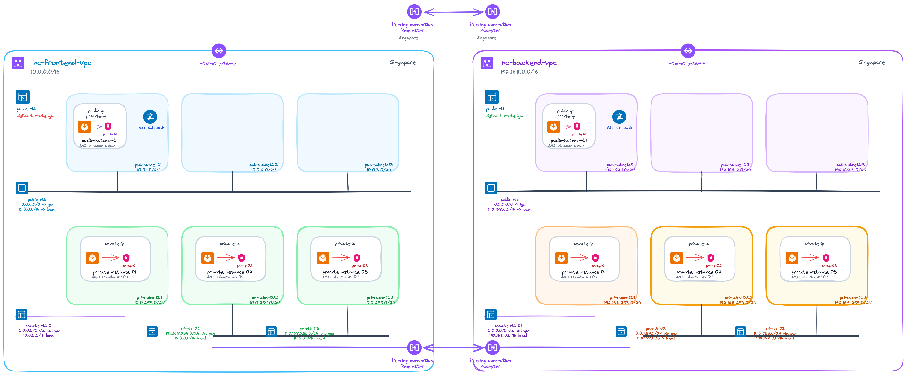
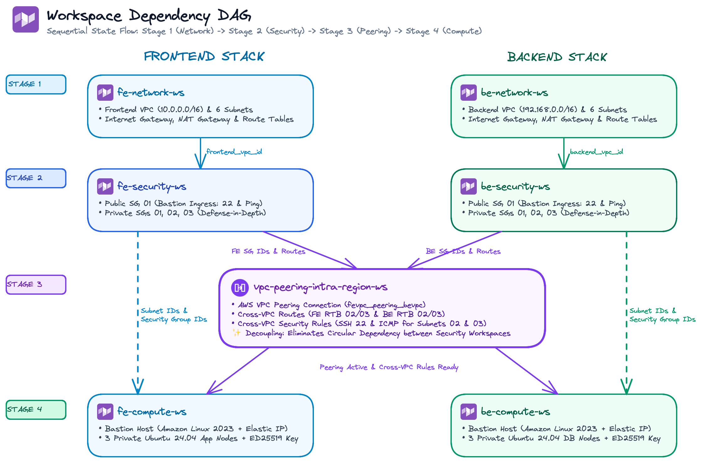

# AWS Intra-Region VPC Peering with HCP Terraform (VCS-Driven)

[](https://www.terraform.io/)
[](https://registry.terraform.io/providers/hashicorp/aws/latest)
[](https://cloud.hashicorp.com/products/terraform)

An enterprise-grade, multi-tier infrastructure architecture on AWS provisioned using **Terraform** and **HCP Terraform (Terraform Cloud)** via a **VCS-driven workflow (GitHub)**.

This repository provisions two fully isolated Virtual Private Clouds (**Frontend VPC** and **Backend VPC**) in the Singapore region (`ap-southeast-1`), connected via **Intra-Region AWS VPC Peering** with selective subnet routing, least-privilege security groups, and automated state management.

> 🎨 **Visual Architecture Diagrams**:
>
> - 🏗 **End-to-End Infrastructure**: [`architecture.png`](./architecture.png)
> - 🔄 **Workspace Dependency DAG**: [`workspace-dependency.png`](./workspace-dependency.png)

---

## 🏗 End-to-End Infrastructure Architecture



---

## 🌐 Network Specifications Summary

| Property              | Frontend VPC     | Backend VPC        | Notes                                    |
| :-------------------- | :--------------- | :----------------- | :--------------------------------------- |
| **AWS Region**        | `ap-southeast-1` | `ap-southeast-1`   | Singapore                                |
| **VPC CIDR**          | `10.0.0.0/16`    | `192.168.0.0/16`   | Non-overlapping IP space                 |
| **Public Subnet 01**  | `10.0.1.0/24`    | `192.168.1.0/24`   | Bastion Host + NAT Gateway               |
| **Public Subnet 02**  | `10.0.2.0/24`    | `192.168.2.0/24`   | Reserved for public services             |
| **Public Subnet 03**  | `10.0.3.0/24`    | `192.168.3.0/24`   | Reserved for public services             |
| **Private Subnet 01** | `10.0.253.0/24`  | `192.168.253.0/24` | Egress internet via NAT Gateway          |
| **Private Subnet 02** | `10.0.254.0/24`  | `192.168.254.0/24` | **Peered Subnet** (Cross-VPC SSH & ICMP) |
| **Private Subnet 03** | `10.0.255.0/24`  | `192.168.255.0/24` | **Peered Subnet** (Cross-VPC SSH & ICMP) |

---

## 📂 Workspaces Directory & Documentation

The codebase is partitioned into **7 distinct workspaces**, each isolated to avoid state lock contention and blast radius:

| Workspace Directory                                             | HCP Workspace     | Layer / Role                                               | Documentation                                                 |
| :-------------------------------------------------------------- | :---------------- | :--------------------------------------------------------- | :------------------------------------------------------------ |
| [`fe-network-ws/`](./fe-network-ws)                             | `vcs-fe-network`  | Frontend VPC, Subnets, IGW, NAT GW, and Route Tables       | [fe-network README](./fe-network-ws/README.md)                |
| [`be-network-ws/`](./be-network-ws)                             | `vcs-be-network`  | Backend VPC, Subnets, IGW, NAT GW, and Route Tables        | [be-network README](./be-network-ws/README.md)                |
| [`fe-security-ws/`](./fe-security-ws)                           | `vcs-fe-security` | Frontend Security Groups & Ingress/Egress Rules            | [fe-security README](./fe-security-ws/README.md)              |
| [`be-security-ws/`](./be-security-ws)                           | `vcs-be-security` | Backend Security Groups & Ingress/Egress Rules             | [be-security README](./be-security-ws/README.md)              |
| [`vpc-peering-intra-region-ws/`](./vpc-peering-intra-region-ws) | `vcs-peering-ws`  | VPC Peering Link, Peering Routes, Cross-VPC SG Rules       | [vpc-peering README](./vpc-peering-intra-region-ws/README.md) |
| [`fe-compute-ws/`](./fe-compute-ws)                             | `vcs-fe-compute`  | Frontend EC2 Instances (Bastion & App nodes), SSH Key, EIP | [fe-compute README](./fe-compute-ws/README.md)                |
| [`be-compute-ws/`](./be-compute-ws)                             | `vcs-be-compute`  | Backend EC2 Instances (Bastion & App nodes), SSH Key, EIP  | [be-compute README](./be-compute-ws/README.md)                |

---

## 🔄 Workspace Dependency DAG



---

## 💡 Key Architectural Design Decisions

### 1. Circular Dependency Elimination

- If `fe-security-ws` referenced `be-security-ws` and vice-versa, neither could be deployed first.
- By placing cross-VPC security group rules into [`vpc-peering-intra-region-ws`](./vpc-peering-intra-region-ws/README.md), both security workspaces deploy independently without deadlock.

### 2. Standalone Security Group Rules

- Implements `aws_vpc_security_group_ingress_rule` and `aws_vpc_security_group_egress_rule` standalone resources rather than legacy inline arguments.
- Benefits:
  - Enables separate workspaces to attach rules to existing security groups without state overwrites.
  - Granular `depends_on = [aws_vpc_peering_connection.fevpc_peering_bevpc]` guarantees rules are only provisioned once peering is active.

### 3. Tiered Least-Privilege Access

- **Public Tier**: Hosts Bastion EC2 instances with Elastic IPs. Ingress is restricted to administrative SSH (Port 22) and ICMP.
- **Private Tier 01**: Internal workloads isolated from external ingress. Outbound internet egress is routed securely through the NAT Gateway.
- **Private Tiers 02 & 03**: Workload subnets wired directly through the VPC Peering connection. Only allowed SSH and ping traffic between peered counterparts.

### 4. Cross-VPC DNS Resolution

- Both Requester and Accepter have `allow_remote_vpc_dns_resolution = true` enabled on the peering connection. Instances can seamlessly communicate using private AWS DNS hostnames across VPC boundaries.

---

## 🚀 Step-by-Step Deployment Guide

### Deployment Sequence

Due to remote state dependencies, workspaces must be applied in the following order:

```
Step 1: fe-network-ws & be-network-ws
   │
   ▼
Step 2: fe-security-ws & be-security-ws
   │
   ▼
Step 3: vpc-peering-intra-region-ws
   │
   ▼
Step 4: fe-compute-ws & be-compute-ws
```

### Option 1: Via HCP Terraform VCS-Driven Workflow (Recommended)

1. Connect this repository to your **HCP Terraform (Terraform Cloud)** organization.
2. Create 7 workspaces pointing to their corresponding directories:
   - `fe-network-ws`: Working directory `fe-network-ws` (Trigger: `fe-network-ws/**/*`)
   - `be-network-ws`: Working directory `be-network-ws` (Trigger: `be-network-ws/**/*`)
   - `fe-security-ws`: Working directory `fe-security-ws` (Trigger: `fe-security-ws/**/*`)
   - `be-security-ws`: Working directory `be-security-ws` (Trigger: `be-security-ws/**/*`)
   - `vpc-peering-intra-region-ws`: Working directory `vpc-peering-intra-region-ws` (Trigger: `vpc-peering-intra-region-ws/**/*`)
   - `fe-compute-ws`: Working directory `fe-compute-ws` (Trigger: `fe-compute-ws/**/*`)
   - `be-compute-ws`: Working directory `be-compute-ws` (Trigger: `be-compute-ws/**/*`)
3. Under **Workspace Settings -> Remote State Sharing**, enable state sharing across all workspaces in the organization.
4. Push changes to `main` branch to trigger automated Plan & Apply.

### Option 2: Via Local CLI

To provision manually from your local terminal:

```bash
# 1. Network Layer
cd fe-network-ws && terraform init && terraform apply -auto-approve && cd ..
cd be-network-ws && terraform init && terraform apply -auto-approve && cd ..

# 2. Security Layer
cd fe-security-ws && terraform init && terraform apply -auto-approve && cd ..
cd be-security-ws && terraform init && terraform apply -auto-approve && cd ..

# 3. Peering Layer
cd vpc-peering-intra-region-ws && terraform init && terraform apply -auto-approve && cd ..

# 4. Compute Layer
cd fe-compute-ws && terraform init && terraform apply -auto-approve && cd ..
cd be-compute-ws && terraform init && terraform apply -auto-approve && cd ..
```

---

## 🔍 Verification & Connectivity Testing

### 1. Extract SSH Keys

Extract the generated private keys for Frontend and Backend instances:

```bash
cd fe-compute-ws
terraform output -raw fe_instances_private_key > fe-sshkey.pem
chmod 400 fe-sshkey.pem
cd ..

cd be-compute-ws
terraform output -raw be_instances_private_key > be-sshkey.pem
chmod 400 be-sshkey.pem
cd ..
```

### 2. Connect via Bastion Jump Host

Use SSH `ProxyJump` to access private instances directly:

```bash
# Access Frontend Private Instance 02
ssh -i fe-compute-ws/fe-sshkey.pem \
    -J ec2-user@<FE_BASTION_EIP> \
    ubuntu@<FE_PRIVATE_INSTANCE_02_IP>
```

### 3. Verify Cross-VPC Peering Ping

From `frontend_private_instance02`, ping `backend_private_instance02`:

```bash
ping -c 4 <BE_PRIVATE_INSTANCE_02_IP>
```

Expected output: 0% packet loss indicating successful route propagation and security group clearance across the VPC peering connection.

---

## 🧹 Teardown / Destruction Order

To destroy all provisioned cloud resources without dependency errors, reverse the deployment sequence:

1. `fe-compute-ws` & `be-compute-ws` (`terraform destroy`)
2. `vpc-peering-intra-region-ws` (`terraform destroy`)
3. `fe-security-ws` & `be-security-ws` (`terraform destroy`)
4. `fe-network-ws` & `be-network-ws` (`terraform destroy`)
