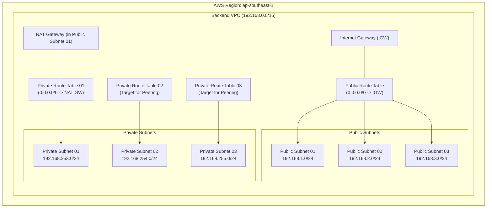

# Backend Network Workspace (`be-network-ws`)

This workspace provisions the **Backend Virtual Private Cloud (VPC)** and associated networking components on AWS using Terraform and HCP Terraform (Terraform Cloud). It serves as the isolated network foundation for backend databases, microservices, and internal workloads in an **Intra-Region VPC Peering** architecture.

---

## 🏗 Architecture Diagram



---

## 🌐 Network Specifications

| Component             | CIDR / Value       | Description                                                             |
| :-------------------- | :----------------- | :---------------------------------------------------------------------- |
| **AWS Region**        | `ap-southeast-1`   | Singapore Region                                                        |
| **VPC CIDR**          | `192.168.0.0/16`   | Backend VPC Address Space (Non-overlapping with Frontend `10.0.0.0/16`) |
| **Public Subnet 01**  | `192.168.1.0/24`   | Houses Bastion Host & NAT Gateway                                       |
| **Public Subnet 02**  | `192.168.2.0/24`   | Reserved for public ingress/egress services                             |
| **Public Subnet 03**  | `192.168.3.0/24`   | Reserved for public ingress/egress services                             |
| **Private Subnet 01** | `192.168.253.0/24` | Outbound Internet access via NAT Gateway                                |
| **Private Subnet 02** | `192.168.254.0/24` | Peering route to Frontend Subnet 02                                     |
| **Private Subnet 03** | `192.168.255.0/24` | Peering route to Frontend Subnet 03                                     |

---

## 📦 Provisioned Resources

- **`aws_vpc.backend_vpc`**: VPC configured with DNS hostnames enabled.
- **`aws_subnet`** (6 subnets):
  - 3 Public Subnets (`backend_public_subnet01`, `02`, `03`)
  - 3 Private Subnets (`backend_private_subnet01`, `02`, `03`)
- **`aws_internet_gateway.backend_igw`**: Internet Gateway for public access and NAT Gateway connectivity.
- **`aws_eip.nat_gateway_eip`**: Static Elastic IP for the Backend NAT Gateway.
- **`aws_nat_gateway.backend_nat_gateway`**: Deployed in `backend_public_subnet01` for secure private subnet outbound internet access.
- **`aws_route_table` & Associations**:
  - `backend_public_rtb`: Routes `0.0.0.0/0` traffic to Internet Gateway.
  - `backend_private_rtb01`: Routes `0.0.0.0/0` traffic to NAT Gateway.
  - `backend_private_rtb02` & `rtb03`: Dedicated route tables whose peering routes are dynamically populated by `vpc-peering-intra-region-ws`.

---

## ⚙️ HCP Terraform Configuration

When configuring this workspace in HCP Terraform:

- **Workspace Name**: `be-network-ws`
- **Terraform Working Directory**: `be-network-ws`
- **VCS Branch**: `main`
- **Automatic run triggering**: `Only trigger runs when files in specified paths change`
  - **Pattern**: `be-network-ws/**/*`
- **Remote State Sharing**:
  - Navigate to **Settings** -> **Remote state sharing**.
  - Ensure **"Share with all workspaces in this organization"** is enabled so downstream workspaces (`be-security-ws`, `be-compute-ws`, `vpc-peering-intra-region-ws`) can read its outputs.

---

## 📥 Inputs (Variables)

| Variable Name                 | Type           | Default                                                        | Description                             |
| :---------------------------- | :------------- | :------------------------------------------------------------- | :-------------------------------------- |
| `region`                      | `string`       | `"ap-southeast-1"`                                             | AWS Region to deploy infrastructure     |
| `backend_vpc_address_space`   | `string`       | `"192.168.0.0/16"`                                             | CIDR block for Backend VPC              |
| `backend_prefix`              | `string`       | `"backend"`                                                    | Prefix for naming and tagging resources |
| `backend_environment`         | `string`       | `"dev"`                                                        | Environment name (e.g. `dev`, `prod`)   |
| `backend_public_subnet_cidr`  | `list(string)` | `["192.168.1.0/24", "192.168.2.0/24", "192.168.3.0/24"]`       | CIDRs for public subnets                |
| `backend_private_subnet_cidr` | `list(string)` | `["192.168.253.0/24", "192.168.254.0/24", "192.168.255.0/24"]` | CIDRs for private subnets               |

---

## 📤 Outputs

These outputs are consumed downstream via `data.tfe_outputs.be_network_source_workspace`:

| Output Name                   | Description                   | Consumed By                                          |
| :---------------------------- | :---------------------------- | :--------------------------------------------------- |
| `backend_vpc_id`              | ID of the created Backend VPC | `be-security-ws`, `vpc-peering-intra-region-ws`      |
| `backend_public_subnet01_id`  | ID of Public Subnet 01        | `be-compute-ws` (Public/Bastion EC2)                 |
| `backend_private_subnet01_id` | ID of Private Subnet 01       | `be-compute-ws` (Private EC2)                        |
| `backend_private_subnet02_id` | ID of Private Subnet 02       | Downstream services                                  |
| `backend_private_subnet03_id` | ID of Private Subnet 03       | Downstream services                                  |
| `backend_public_subnet_cidr`  | List of public CIDR blocks    | Downstream routing / security                        |
| `backend_private_subnet_cidr` | List of private CIDR blocks   | `vpc-peering-intra-region-ws` (Route destination)    |
| `backend_private_rtb02_id`    | ID of Private Route Table 02  | `vpc-peering-intra-region-ws` (Peering route target) |
| `backend_private_rtb03_id`    | ID of Private Route Table 03  | `vpc-peering-intra-region-ws` (Peering route target) |

---

## 🚀 Deployment Instructions

### Option 1: Via HCP Terraform (Recommended)

1. Push your changes to the `main` branch:
   ```bash
   git add be-network-ws/
   git commit -m "feat: update BE network"
   git push origin main
   ```
2. HCP Terraform automatically triggers a Plan and Apply based on the VCS trigger pattern `be-network-ws/**/*`.

### Option 2: Via Local CLI

```bash
cd be-network-ws
terraform init
terraform plan
terraform apply
```
