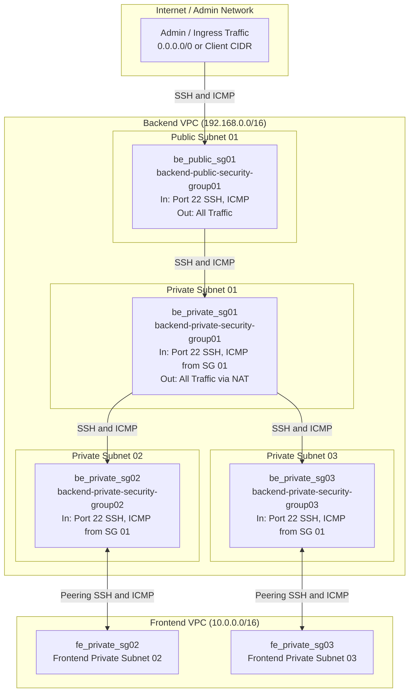
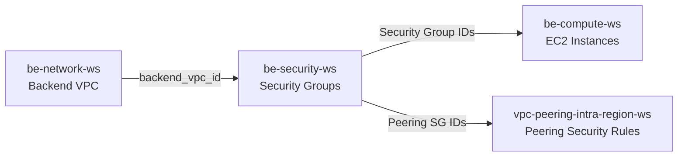

# Backend Security Workspace (`be-security-ws`)

This workspace provisions and manages the **AWS Security Groups and Security Rules** for the Backend VPC using Terraform and HCP Terraform (Terraform Cloud). It establishes a defense-in-depth security boundary across backend public and private subnets, ensuring isolated, least-privilege traffic flow for backend database/application tiers and enabling cross-VPC peering communication with the frontend infrastructure.

---

## 🏗 Architecture & Traffic Flow Diagram



---

## 🛡️ Security Group Specifications

| Security Group | Resource Name | Associated Tier | Ingress Rules | Egress Rules |
| :--- | :--- | :--- | :--- | :--- |
| **`be_public_sg01`** | `backend-public-security-group01` | Public Subnet 01 (Bastion Host) | • **Port 22 (TCP)** from `var.backend_public_subnet_cidr`<br/>• **ICMP (Echo Request)** from `var.backend_public_subnet_cidr` | • **All Traffic (`-1`)** to `0.0.0.0/0` |
| **`be_private_sg01`** | `backend-private-security-group01` | Private Subnet 01 (Internal Jump/App) | • **Port 22 (TCP)** from `be_public_sg01`<br/>• **ICMP** from `be_public_sg01` | • **All Traffic (`-1`)** to `0.0.0.0/0` (Egress via NAT) |
| **`be_private_sg02`** | `backend-private-security-group02` | Private Subnet 02 (App/DB Tier / Peered) | • **Port 22 (TCP)** from `be_private_sg01`<br/>• **ICMP** from `be_private_sg01` | Inter-VPC peering egress managed in `vpc-peering-intra-region-ws` |
| **`be_private_sg03`** | `backend-private-security-group03` | Private Subnet 03 (App/DB Tier / Peered) | • **Port 22 (TCP)** from `be_private_sg01`<br/>• **ICMP** from `be_private_sg01` | Inter-VPC peering egress managed in `vpc-peering-intra-region-ws` |

> **Best Practice Note**: This workspace utilizes `aws_vpc_security_group_ingress_rule` and `aws_vpc_security_group_egress_rule` standalone resources rather than inline security group arguments. This avoids circular dependencies, state locks, and enables clean cross-workspace rule composition across VPC peering connections.

---

## 📦 Provisioned Resources

- **`aws_security_group.be_public_sg01`**: Security group for public instances (Bastion host) attached to `backend_vpc_id`.
  - `aws_vpc_security_group_ingress_rule.be_public_sg01_allow_ssh`: Ingress SSH from allowed CIDR.
  - `aws_vpc_security_group_ingress_rule.be_public_sg01_allow_icmp`: Ingress ICMP (ping) from allowed CIDR.
  - `aws_vpc_security_group_egress_rule.be_public_sg01_allow_all_traffic`: Unrestricted outbound egress.
- **`aws_security_group.be_private_sg01`**: Security group for private tier 01 instances.
  - `aws_vpc_security_group_ingress_rule.be_private_sg01_allow_ssh`: Ingress SSH strictly from `be_public_sg01`.
  - `aws_vpc_security_group_ingress_rule.be_private_sg01_allow_icmp`: Ingress ICMP strictly from `be_public_sg01`.
  - `aws_vpc_security_group_egress_rule.be_private_sg01_allow_all_traffic`: Unrestricted egress for package downloads/updates via NAT Gateway.
- **`aws_security_group.be_private_sg02`**: Security group for private tier 02 instances.
  - `aws_vpc_security_group_ingress_rule.be_private_sg02_allow_ssh_from_be_private_sg01`: Ingress SSH from `be_private_sg01`.
  - `aws_vpc_security_group_ingress_rule.be_private_sg02_allow_icmp_from_be_private_sg01`: Ingress ICMP from `be_private_sg01`.
- **`aws_security_group.be_private_sg03`**: Security group for private tier 03 instances.
  - `aws_vpc_security_group_ingress_rule.be_private_sg03_allow_ssh_from_be_private_sg01`: Ingress SSH from `be_private_sg01`.
  - `aws_vpc_security_group_ingress_rule.be_private_sg03_allow_icmp_from_be_private_sg01`: Ingress ICMP from `be_private_sg01`.

---

## 🔗 Workspace Dependencies



1. **Upstream**: Reads `backend_vpc_id` from `be-network-ws` (or workspace specified by `var.be_network_workspace_name`) using `tfe_outputs`.
2. **Downstream**:
   - `be-compute-ws`: Attaches the security groups to EC2 instances in each respective backend subnet.
   - `vpc-peering-intra-region-ws`: Attaches inter-VPC ingress and egress rules linking Frontend and Backend private security groups.

---

## ⚙️ HCP Terraform Configuration

When configuring this workspace in HCP Terraform:

- **Workspace Name**: `be-security-ws` (or `vcs-be-security`)
- **Terraform Working Directory**: `be-security-ws`
- **VCS Branch**: `main`
- **Automatic run triggering**: `Only trigger runs when files in specified paths change`
  - **Pattern**: `be-security-ws/**/*`
- **Remote State Sharing**:
  - Navigate to **Settings** -> **Remote state sharing**.
  - Enable **"Share with all workspaces in this organization"** (or selectively share with `be-compute-ws` and `vpc-peering-intra-region-ws`).

---

## 📥 Inputs (Variables)

| Variable Name | Type | Default | Description |
| :--- | :--- | :--- | :--- |
| `region` | `string` | `"ap-southeast-1"` | AWS Region to deploy security resources |
| `backend_prefix` | `string` | `"backend"` | Prefix used for security group naming and tags |
| `backend_environment` | `string` | `"dev"` | Environment name (e.g. `dev`, `prod`) |
| `organization_name` | `string` | `"achn-testing"` | HCP Terraform organization hosting the upstream workspace |
| `be_network_workspace_name` | `string` | `"vcs-be-network"` | Name of the upstream network workspace to fetch `backend_vpc_id` |
| `backend_public_subnet_cidr` | `string` | `"0.0.0.0/0"` | CIDR block permitted for public SSH / ICMP ingress to Bastion Host |

---

## 📤 Outputs

These outputs are consumed downstream via `data.tfe_outputs.be_security_source_workspace`:

| Output Name | Description | Consumed By |
| :--- | :--- | :--- |
| `backend_public_sg01_id` | ID of `be_public_sg01` (Public Bastion SG) | `be-compute-ws` (Public Bastion EC2) |
| `backend_private_sg01_id` | ID of `be_private_sg01` (Private Tier 01 SG) | `be-compute-ws` (Private Subnet 01 EC2) |
| `backend_private_sg02_id` | ID of `be_private_sg02` (Private Tier 02 SG) | `be-compute-ws`, `vpc-peering-intra-region-ws` |
| `backend_private_sg03_id` | ID of `be_private_sg03` (Private Tier 03 SG) | `be-compute-ws`, `vpc-peering-intra-region-ws` |

---

## 🚀 Deployment Instructions

### Option 1: Via HCP Terraform (Recommended)

1. Commit and push your changes to `main`:
   ```bash
   git add be-security-ws/
   git commit -m "feat: add be-security documentation"
   git push origin main
   ```
2. HCP Terraform automatically triggers a Plan and Apply based on the VCS trigger pattern `be-security-ws/**/*`.

### Option 2: Via Local CLI

```bash
cd be-security-ws
terraform init
terraform plan
terraform apply
```
