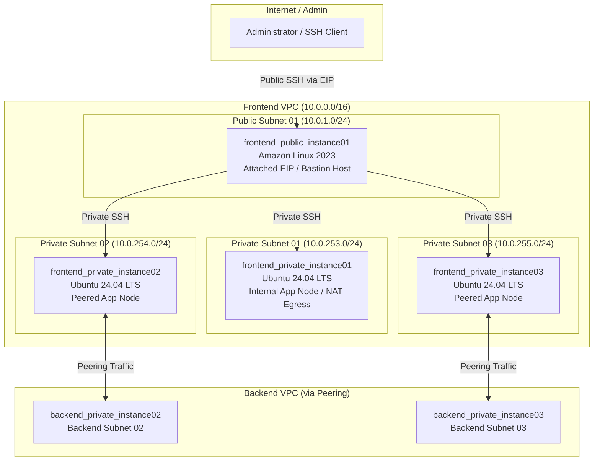
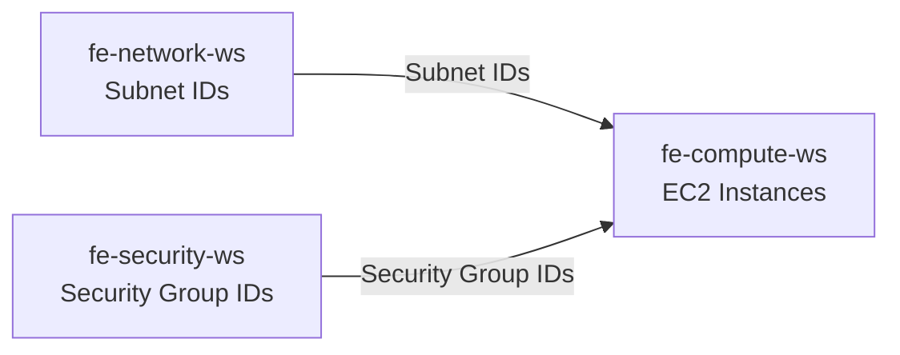

# Frontend Compute Workspace (`fe-compute-ws`)

This workspace provisions and manages the **EC2 Compute Instances, Elastic IPs (EIP), and SSH Key Pairs** within the Frontend VPC (`10.0.0.0/16`) in the Singapore region (`ap-southeast-1`) using Terraform and HCP Terraform (Terraform Cloud).

It establishes a public Bastion host for administrative ingress alongside private Ubuntu workload instances configured for intra-VPC operations and inter-VPC peering connectivity with the backend infrastructure.

---

## 🏗 Architecture & Compute Topology



---

## 💻 Compute Instance Specifications

| Instance Resource | Subnet | OS / AMI | Security Group | Public Access | Role & Description |
| :--- | :--- | :--- | :--- | :--- | :--- |
| **`frontend_public_instance01`** | `Public Subnet 01`<br/>(`10.0.1.0/24`) | **Amazon Linux 2023**<br/>(Kernel 6.18, x86_64) | `frontend_public_sg01` | **Yes**<br/>(Static Elastic IP) | **Bastion Host / Web**: Public entry point for jump-box SSH access into private subnets. |
| **`frontend_private_instance01`** | `Private Subnet 01`<br/>(`10.0.253.0/24`) | **Ubuntu 24.04 LTS**<br/>(Noble Numbat, amd64) | `frontend_private_sg01` | **No** (Private only) | **Private App Node**: Accessible via SSH from Bastion; outbound internet access via NAT Gateway. |
| **`frontend_private_instance02`** | `Private Subnet 02`<br/>(`10.0.254.0/24`) | **Ubuntu 24.04 LTS**<br/>(Noble Numbat, amd64) | `frontend_private_sg02` | **No** (Private only) | **Peered Workload Node**: Bi-directionally connected to Backend Private Subnet 02 via VPC peering. |
| **`frontend_private_instance03`** | `Private Subnet 03`<br/>(`10.0.255.0/24`) | **Ubuntu 24.04 LTS**<br/>(Noble Numbat, amd64) | `frontend_private_sg03` | **No** (Private only) | **Peered Workload Node**: Bi-directionally connected to Backend Private Subnet 03 via VPC peering. |

---

## 🔑 SSH Key Pair Management

- **Resource**: `tls_private_key.fe_keypair` creates an **ED25519** keypair.
- **AWS Key Pair**: `aws_key_pair.fe_keypair` (`frontend-ssh-key.pem`) deployed to all frontend EC2 instances.
- **Accessing Private Key**:
  The private key is exposed as a sensitive Terraform output:
  ```bash
  terraform output -raw fe_instances_private_key > fe-sshkey.pem
  chmod 400 fe-sshkey.pem
  ```
- **Connecting via Bastion**:
  ```bash
  # SSH to Bastion Host
  ssh -i fe-sshkey.pem ec2-user@<FRONTEND_PUBLIC_IP>

  # SSH to Private Instance from Bastion
  ssh -i fe-sshkey.pem ubuntu@<FRONTEND_PRIVATE_IP>

  # Or using SSH ProxyJump:
  ssh -i fe-sshkey.pem -J ec2-user@<FRONTEND_PUBLIC_IP> ubuntu@<FRONTEND_PRIVATE_IP>
  ```

---

## 📦 Provisioned Resources

- **`tls_private_key.fe_keypair`**: Generates high-security ED25519 SSH private key.
- **`aws_key_pair.fe_keypair`**: Registers public key on AWS as `${var.frontend_prefix}-ssh-key.pem`.
- **`aws_eip.frontend_public_instance_eip`**: Allocates Elastic IP for the Bastion instance.
- **`aws_eip_association.fe_public_instance_eip_assoc`**: Associates the Elastic IP with `frontend_public_instance01`.
- **`aws_instance.frontend_public_instance01`**: Amazon Linux 2023 EC2 instance deployed in Public Subnet 01.
- **`aws_instance.frontend_private_instance01`**: Ubuntu 24.04 LTS instance deployed in Private Subnet 01.
- **`aws_instance.frontend_private_instance02`**: Ubuntu 24.04 LTS instance deployed in Private Subnet 02 (peering target).
- **`aws_instance.frontend_private_instance03`**: Ubuntu 24.04 LTS instance deployed in Private Subnet 03 (peering target).

---

## 🔗 Workspace Dependencies



This workspace queries outputs from two upstream workspaces:

1. **`fe-network-ws`** (via `data.tfe_outputs.fe_network_source_workspace`):
   - `frontend_public_subnet01_id`
   - `frontend_private_subnet01_id`
   - `frontend_private_subnet02_id`
   - `frontend_private_subnet03_id`
2. **`fe-security-ws`** (via `data.tfe_outputs.fe_security_source_workspace`):
   - `frontend_public_sg01_id`
   - `frontend_private_sg01_id`
   - `frontend_private_sg02_id`
   - `frontend_private_sg03_id`

---

## ⚙️ HCP Terraform Configuration

When configuring this workspace in HCP Terraform:

- **Workspace Name**: `fe-compute-ws` (or `vcs-fe-compute`)
- **Terraform Working Directory**: `fe-compute-ws`
- **VCS Branch**: `main`
- **Automatic run triggering**: `Only trigger runs when files in specified paths change`
  - **Pattern**: `fe-compute-ws/**/*`
- **Upstream Workspace Permissions**:
  - Ensure `fe-network-ws` and `fe-security-ws` have **Remote State Sharing** enabled with this workspace.

---

## 📥 Inputs (Variables)

| Variable Name | Type | Default | Description |
| :--- | :--- | :--- | :--- |
| `region` | `string` | `"ap-southeast-1"` | AWS Region to deploy compute instances |
| `frontend_prefix` | `string` | `"frontend"` | Prefix for naming and tagging resources |
| `frontend_environment` | `string` | `"dev"` | Environment name (e.g. `dev`, `prod`) |
| `fe_instance_type` | `string` | `"t3.micro"` | AWS EC2 instance type |
| `organization_name` | `string` | `"achn-testing"` | HCP Terraform organization hosting upstream workspaces |
| `fe_network_workspace_name` | `string` | `"vcs-fe-network"` | Name of the frontend network workspace to query |
| `fe_security_workspace_name` | `string` | `"vcs-fe-security"` | Name of the frontend security workspace to query |
| `fe_placeholder` | `string` | `"placedog.net"` | Image placeholder service URL for web template |
| `placeholder_id` | `string` | `"2"` | Placeholder image ID |
| `width` | `string` | `"600"` | Placeholder image width in pixels |
| `height` | `string` | `"400"` | Placeholder image height in pixels |

---

## 📤 Outputs

| Output Name | Description | Sensitive |
| :--- | :--- | :--- |
| `fe_instances_private_key` | Private key for SSH access (ED25519) | **Yes** |
| `frontend_public_instance_public_ip` | Elastic IP assigned to Bastion instance | No |
| `frontend_public_instance_public_dns` | Public DNS hostname of Bastion instance | No |
| `frontend_private_instance01_private_ip` | Private IPv4 of Private Instance 01 | No |
| `frontend_private_instance02_private_ip` | Private IPv4 of Private Instance 02 | No |
| `frontend_private_instance03_private_ip` | Private IPv4 of Private Instance 03 | No |

---

## 🚀 Deployment Instructions

### Deployment Prerequisite

Ensure the following upstream workspaces have been applied in order:
1. `fe-network-ws`
2. `fe-security-ws`
3. `vpc-peering-intra-region-ws` (recommended before starting workloads)

### Option 1: Via HCP Terraform (Recommended)

1. Commit and push your changes to `main`:
   ```bash
   git add fe-compute-ws/
   git commit -m "feat: add fe-compute documentation"
   git push origin main
   ```
2. HCP Terraform automatically triggers a Plan and Apply based on the VCS trigger pattern `fe-compute-ws/**/*`.

### Option 2: Via Local CLI

```bash
cd fe-compute-ws
terraform init
terraform plan
terraform apply
```
