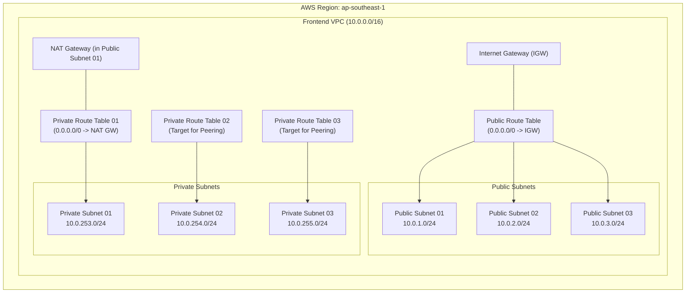

# Frontend Network Workspace (`fe-network-ws`)

This workspace provisions the **Frontend Virtual Private Cloud (VPC)** and associated networking components on AWS using Terraform and HCP Terraform (Terraform Cloud). It serves as the network foundation for the frontend tier (Web/Public Bastion instances and Frontend Application servers) in an **Intra-Region VPC Peering** architecture.

---

## 🏗 Architecture Diagram



---

## 🌐 Network Specifications

| Component | CIDR / Value | Description |
| :--- | :--- | :--- |
| **AWS Region** | `ap-southeast-1` | Singapore Region |
| **VPC CIDR** | `10.0.0.0/16` | Frontend VPC Address Space |
| **Public Subnet 01** | `10.0.1.0/24` | Houses Bastion Host & NAT Gateway |
| **Public Subnet 02** | `10.0.2.0/24` | Reserved for public services |
| **Public Subnet 03** | `10.0.3.0/24` | Reserved for public services |
| **Private Subnet 01** | `10.0.253.0/24` | Outbound Internet access via NAT Gateway |
| **Private Subnet 02** | `10.0.254.0/24` | Peering route to Backend Subnet 02 |
| **Private Subnet 03** | `10.0.255.0/24` | Peering route to Backend Subnet 03 |

---

## 📦 Provisioned Resources

- **`aws_vpc.frontend_vpc`**: VPC with DNS hostnames enabled.
- **`aws_subnet`** (6 subnets):
  - 3 Public Subnets (`frontend_public_subnet01`, `02`, `03`)
  - 3 Private Subnets (`frontend_private_subnet01`, `02`, `03`)
- **`aws_internet_gateway.frontend_igw`**: Direct outbound/inbound access for public subnets.
- **`aws_eip.nat_gateway_eip`**: Static Elastic IP for the NAT Gateway.
- **`aws_nat_gateway.frontend_nat_gateway`**: Deployed in `frontend_public_subnet01` to provide internet egress for private workloads.
- **`aws_route_table` & Associations**:
  - `frontend_public_rtb`: Routes `0.0.0.0/0` traffic to Internet Gateway.
  - `frontend_private_rtb01`: Routes `0.0.0.0/0` traffic to NAT Gateway.
  - `frontend_private_rtb02` & `rtb03`: Dedicated route tables whose peering routes are dynamically populated by `vpc-peering-intra-region-ws`.

---

## ⚙️ HCP Terraform Configuration

When configuring this workspace in HCP Terraform:

- **Workspace Name**: `fe-network-ws` (or your chosen naming convention)
- **Terraform Working Directory**: `fe-network-ws`
- **VCS Branch**: `main`
- **Automatic run triggering**: `Only trigger runs when files in specified paths change`
  - **Pattern**: `fe-network-ws/**/*`
- **Remote State Sharing**: 
  - Navigate to **Settings** -> **Remote state sharing**.
  - Ensure **"Share with all workspaces in this organization"** is enabled so downstream workspaces (`fe-security-ws`, `fe-compute-ws`, `vpc-peering-intra-region-ws`) can read its outputs.

---

## 📥 Inputs (Variables)

| Variable Name | Type | Default | Description |
| :--- | :--- | :--- | :--- |
| `region` | `string` | `"ap-southeast-1"` | AWS Region to deploy infrastructure |
| `frontend_vpc_address_space` | `string` | `"10.0.0.0/16"` | CIDR block for Frontend VPC |
| `frontend_prefix` | `string` | `"frontend"` | Prefix for naming and tagging resources |
| `frontend_environment` | `string` | `"dev"` | Environment name (e.g. `dev`, `prod`) |
| `frontend_public_subnet_cidr` | `list(string)` | `["10.0.1.0/24", "10.0.2.0/24", "10.0.3.0/24"]` | CIDRs for public subnets |
| `frontend_private_subnet_cidr` | `list(string)` | `["10.0.253.0/24", "10.0.254.0/24", "10.0.255.0/24"]` | CIDRs for private subnets |

---

## 📤 Outputs

These outputs are consumed downstream via `data.tfe_outputs.fe_network_source_workspace`:

| Output Name | Description | Consumed By |
| :--- | :--- | :--- |
| `frontend_vpc_id` | ID of the created Frontend VPC | `fe-security-ws`, `vpc-peering-intra-region-ws` |
| `frontend_public_subnet01_id` | ID of Public Subnet 01 | `fe-compute-ws` (Public/Bastion EC2) |
| `frontend_private_subnet01_id` | ID of Private Subnet 01 | `fe-compute-ws` (Private EC2) |
| `frontend_private_subnet02_id` | ID of Private Subnet 02 | Downstream services |
| `frontend_private_subnet03_id` | ID of Private Subnet 03 | Downstream services |
| `frontend_public_subnet_cidr` | List of public CIDR blocks | Downstream routing / security |
| `frontend_private_subnet_cidr` | List of private CIDR blocks | `vpc-peering-intra-region-ws` (Route destination) |
| `frontend_private_rtb02_id` | ID of Private Route Table 02 | `vpc-peering-intra-region-ws` (Peering route target) |
| `frontend_private_rtb03_id` | ID of Private Route Table 03 | `vpc-peering-intra-region-ws` (Peering route target) |

---

## 🚀 Deployment Instructions

### Option 1: Via HCP Terraform (Recommended)
1. Push your changes to the `main` branch:
   ```bash
   git add fe-network-ws/
   git commit -m "feat: update fe network"
   git push origin main
   ```
2. HCP Terraform automatically triggers a Plan and Apply based on the VCS trigger pattern `fe-network-ws/**/*`.

### Option 2: Via Local CLI
```bash
cd fe-network-ws
terraform init
terraform plan
terraform apply
```
