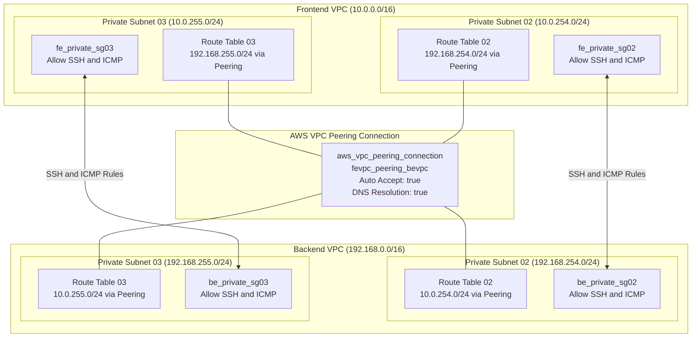
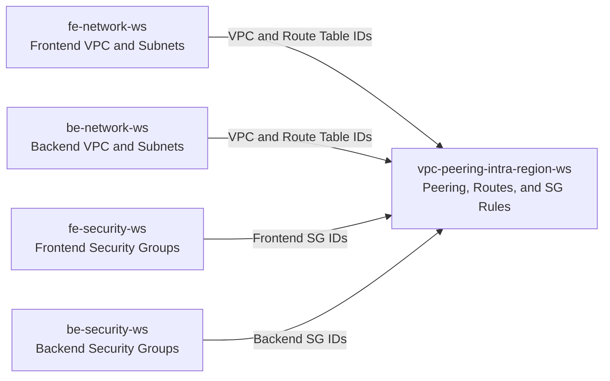

# VPC Peering Intra-Region Workspace (`vpc-peering-intra-region-ws`)

This workspace provisions and manages the **AWS VPC Peering Connection**, **Inter-VPC Routing Tables**, and **Cross-VPC Security Group Firewall Rules** between the Frontend VPC (`10.0.0.0/16`) and the Backend VPC (`192.168.0.0/16`) in the Singapore region (`ap-southeast-1`) using Terraform and HCP Terraform (Terraform Cloud).

By isolating the peering link and cross-VPC security rules into this dedicated workspace, the architecture eliminates **circular dependencies** between frontend and backend workspaces while enforcing least-privilege private connectivity.

---

## 🏗 Architecture & Peering Traffic Flow Diagram



---

## 🎯 Architecture Highlights & Key Decisions

1. **Circular Dependency Prevention**:
   - If `fe-security-ws` referenced `be-security-ws` and vice versa, Terraform could not apply either workspace first.
   - Cross-VPC security rules reference remote security group IDs from both sides. Housing them here ensures `fe-security-ws` and `be-security-ws` provision independently without circular blocks.
2. **Subnet-Level Isolation (Subnet 02 & 03 Only)**:
   - Public Subnet 01 and Private Subnet 01 in both VPCs do **not** route directly to the peer VPC.
   - Only dedicated workload subnets (Private Subnets 02 and 03) possess routing table entries pointing to the peering connection.
3. **Cross-VPC DNS Resolution**:
   - Both `accepter` and `requester` blocks have `allow_remote_vpc_dns_resolution = true` enabled, allowing EC2 instances to resolve private DNS hostnames across peered VPCs.
4. **Standalone Security Group Rules**:
   - Uses `aws_vpc_security_group_ingress_rule` and `aws_vpc_security_group_egress_rule` with explicit `depends_on = [aws_vpc_peering_connection.fevpc_peering_bevpc]` to guarantee the peering connection is active before rules are applied.

---

## 📦 Provisioned Resources

### 1. VPC Peering Connection (`peering.tf`)

- **`aws_vpc_peering_connection.fevpc_peering_bevpc`**:
  - Requester: Frontend VPC (`frontend_vpc_id`)
  - Accepter: Backend VPC (`backend_vpc_id`)
  - `auto_accept = true` (intra-account, intra-region)
  - `allow_remote_vpc_dns_resolution = true` on both sides

### 2. Route Table Entries (`peering.tf`)

| Route Resource | Source Route Table | Destination CIDR | Target |
| :--- | :--- | :--- | :--- |
| `fevpc_private_subnet02_to_bevpc_private_subnet02` | `frontend_private_rtb02` | `192.168.254.0/24` (BE Subnet 02) | VPC Peering Connection |
| `fevpc_private_subnet03_to_bevpc_private_subnet03` | `frontend_private_rtb03` | `192.168.255.0/24` (BE Subnet 03) | VPC Peering Connection |
| `bevpc_private_subnet02_to_fevpc_private_subnet02` | `backend_private_rtb02` | `10.0.254.0/24` (FE Subnet 02) | VPC Peering Connection |
| `bevpc_private_subnet03_to_fevpc_private_subnet03` | `backend_private_rtb03` | `10.0.255.0/24` (FE Subnet 03) | VPC Peering Connection |

### 3. Cross-VPC Security Rules (`security_group.tf`)

#### Private Subnet 02 Pair (`fe_private_sg02` ↔ `be_private_sg02`):
- `fe_private_sg02_allow_ssh_from_be_private_sg02`: Ingress TCP port 22 from `be_private_sg02`
- `fe_private_sg02_allow_icmp_from_be_private_sg02`: Ingress ICMP (ping) from `be_private_sg02`
- `be_private_sg02_allow_ssh_to_be_private_sg02`: Egress TCP port 22 to `be_private_sg02`
- `be_private_sg02_allow_icmp_to_be_private_sg02`: Egress ICMP to `be_private_sg02`
- `be_private_sg02_allow_ssh_from_fe_private_sg02`: Ingress TCP port 22 from `fe_private_sg02`
- `be_private_sg02_allow_icmp_from_be_private_sg02`: Ingress ICMP from `fe_private_sg02`
- `be_private_sg02_allow_ssh_to_fe_private_sg02`: Egress TCP port 22 to `fe_private_sg02`
- `be_private_sg02_allow_icmp_to_fe_private_sg02`: Egress ICMP to `fe_private_sg02`

#### Private Subnet 03 Pair (`fe_private_sg03` ↔ `be_private_sg03`):
- `fe_private_sg03_allow_ssh_from_be_private_sg03`: Ingress TCP port 22 from `be_private_sg03`
- `fe_private_sg03_allow_icmp_from_be_private_sg03`: Ingress ICMP (ping) from `be_private_sg03`
- `be_private_sg03_allow_ssh_to_be_private_sg02`: Egress TCP port 22 to `be_private_sg03`
- `be_private_sg03_allow_icmp_to_be_private_sg03`: Egress ICMP to `be_private_sg03`
- `be_private_sg03_allow_ssh_from_fe_private_sg03`: Ingress TCP port 22 from `fe_private_sg03`
- `be_private_sg03_allow_icmp_from_be_private_sg03`: Ingress ICMP from `fe_private_sg03`
- `be_private_sg03_allow_ssh_to_fe_private_sg03`: Egress TCP port 22 to `fe_private_sg03`
- `be_private_sg03_allow_icmp_to_fe_private_sg03`: Egress ICMP to `fe_private_sg03`

---

## 🔗 Workspace Dependencies



This workspace queries remote state outputs from 4 upstream workspaces via `data.tf`:

1. **`data.tfe_outputs.fe_network_source_workspace`**:
   - `frontend_vpc_id`
   - `frontend_private_rtb02_id`, `frontend_private_rtb03_id`
   - `frontend_private_subnet_cidr`
2. **`data.tfe_outputs.be_network_source_workspace`**:
   - `backend_vpc_id`
   - `backend_private_rtb02_id`, `backend_private_rtb03_id`
   - `backend_private_subnet_cidr`
3. **`data.tfe_outputs.fe_security_source_workspace`**:
   - `frontend_private_sg02_id`, `frontend_private_sg03_id`
4. **`data.tfe_outputs.be_security_source_workspace`**:
   - `backend_private_sg02_id`, `backend_private_sg03_id`

---

## ⚙️ HCP Terraform Configuration

When configuring this workspace in HCP Terraform:

- **Workspace Name**: `vpc-peering-intra-region-ws` (or `vcs-peering-ws`)
- **Terraform Working Directory**: `vpc-peering-intra-region-ws`
- **VCS Branch**: `main`
- **Automatic run triggering**: `Only trigger runs when files in specified paths change`
  - **Pattern**: `vpc-peering-intra-region-ws/**/*`
- **Upstream Workspace Permissions**:
  - Ensure that `fe-network-ws`, `be-network-ws`, `fe-security-ws`, and `be-security-ws` have enabled **Remote State Sharing** so this workspace can read their outputs.

---

## 📥 Inputs (Variables)

| Variable Name | Type | Default | Description |
| :--- | :--- | :--- | :--- |
| `region` | `string` | `"ap-southeast-1"` | AWS Region where peering resources are provisioned |
| `organization_name` | `string` | `"achn-testing"` | HCP Terraform organization hosting upstream workspaces |
| `fe_network_workspace_name` | `string` | `"vcs-fe-network"` | Name of the frontend network workspace to query |
| `be_network_workspace_name` | `string` | `"vcs-be-network"` | Name of the backend network workspace to query |
| `fe_security_workspace_name` | `string` | `"vcs-fe-security"` | Name of the frontend security workspace to query |
| `be_security_workspace_name` | `string` | `"vcs-be-security"` | Name of the backend security workspace to query |

---

## 🚀 Deployment Instructions

### Deployment Sequence

Due to inter-workspace dependencies, workspaces should be deployed in this order:

1. `fe-network-ws` & `be-network-ws` (VPCs, Subnets, Gateways, Route Tables)
2. `fe-security-ws` & `be-security-ws` (Base Security Groups)
3. **`vpc-peering-intra-region-ws`** (Peering connection, Cross-VPC Routes, Peering SG Rules)
4. `fe-compute-ws` & `be-compute-ws` (EC2 Instances in respective subnets)

### Option 1: Via HCP Terraform (Recommended)

1. Commit and push your changes to `main`:
   ```bash
   git add vpc-peering-intra-region-ws/
   git commit -m "feat: add vpc-peering documentation"
   git push origin main
   ```
2. HCP Terraform automatically triggers a Plan and Apply based on the VCS trigger pattern `vpc-peering-intra-region-ws/**/*`.

### Option 2: Via Local CLI

```bash
cd vpc-peering-intra-region-ws
terraform init
terraform plan
terraform apply
```
